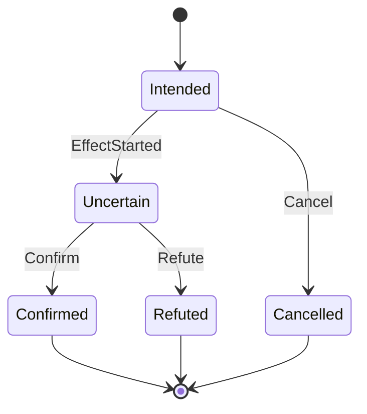
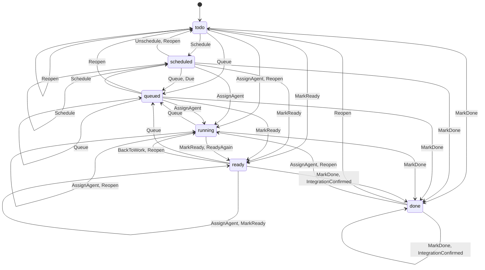

# State machines: attempts and tasks

The two state machines of the domain core, built on 19 November 2026. Words
follow [GLOSSARY.md](../../GLOSSARY.md). Old paths are in the fork checkout at
`9859c344`; `ht/` is `mods/tasks/bin/herdr_task/`.

- `src/domains/attempt/`: `transitionAttempt(attempt, event)`.
- `src/domains/task/`: `transitionTask(task, event)`.

Each is a pure function that returns the next state or a typed refusal. Each
reads one table, `attemptTransitions` or `taskTransitions`.
`tests/state-machines-note.test.ts` fails when a diagram or a table below
differs from those tables.

## Attempt

| State     | EffectStarted                  | Confirm                   | Refute                    | Cancel                           |
| --------- | ------------------------------ | ------------------------- | ------------------------- | -------------------------------- |
| Intended  | Uncertain                      | refused: EffectNotStarted | refused: EffectNotStarted | Cancelled                        |
| Uncertain | refused: UncertainNeverRetried | Confirmed                 | Refuted                   | refused: UncertainNeverCancelled |
| Confirmed | refused: AttemptResolved       | refused: AttemptResolved  | refused: AttemptResolved  | refused: AttemptResolved         |
| Refuted   | refused: AttemptResolved       | refused: AttemptResolved  | refused: AttemptResolved  | refused: AttemptResolved         |
| Cancelled | refused: AttemptResolved       | refused: AttemptResolved  | refused: AttemptResolved  | refused: AttemptResolved         |

- `EffectStarted` is the kernel's `effect-started` record: the effect is
  about to be called.
- `Confirm` carries positive evidence and `Refute` carries refuting evidence.
  Evidence names the attempt id it was observed for. Evidence for another
  attempt is refused as `EvidenceForAnotherAttempt`, whatever the table says.
- An Uncertain attempt leaves only on evidence. The effect starting again
  would be a retry, so it is refused. So is a cancel, by anyone.
- The table does not say who presents evidence, or when. So `Refute` is the
  one way out for an Uncertain attempt whose effect never happened, also
  after its run has stopped. Seeing no result is not refuting evidence, and
  no event can be made from it.
- `Cancel` says who cancelled: the attempt owner's own run, or the person.
  No other value type-checks, so the tick cannot cancel an Intended attempt
  whose attempt owner is gone (open question 3 in
  [module-map.md](module-map.md)).
- A Confirmed attempt stores its positive evidence, a Refuted one its
  refuting evidence, a Cancelled one who cancelled it and why. A state
  without these does not decode.

## Task

A cell names the next stored state, or the refusal. Any caller not listed
under By is refused as `CallerMayNot`.

| Event                | By                           | todo                           | scheduled           | queued                | running                 | ready                   | done                           |
| -------------------- | ---------------------------- | ------------------------------ | ------------------- | --------------------- | ----------------------- | ----------------------- | ------------------------------ |
| Schedule             | person, assistant            | scheduled                      | scheduled           | scheduled             | refused: AlreadyStarted | refused: AlreadyStarted | refused: AlreadyStarted        |
| Unschedule           | person, assistant            | refused: NotScheduled          | todo                | refused: NotScheduled | refused: NotScheduled   | refused: NotScheduled   | refused: NotScheduled          |
| Queue                | person, assistant, scheduler | queued                         | queued              | queued                | queued                  | queued                  | refused: TaskDone              |
| Due                  | scheduler                    | refused: NotScheduled          | queued              | refused: NotScheduled | refused: NotScheduled   | refused: NotScheduled   | refused: NotScheduled          |
| AssignAgent          | person, assistant, scheduler | running                        | running             | running               | running                 | ready                   | running                        |
| MarkReady            | person, worker               | ready                          | ready               | ready                 | ready                   | ready                   | refused: TaskDone              |
| BackToWork           | person, assistant, scheduler | refused: NotReady              | refused: NotReady   | refused: NotReady     | refused: NotReady       | running                 | refused: NotReady              |
| ReadyAgain           | scheduler                    | refused: NotRunning            | refused: NotRunning | refused: NotRunning   | ready                   | refused: NotRunning     | refused: NotRunning            |
| MarkDone             | person, assistant            | done                           | done                | done                  | done                    | done                    | done                           |
| IntegrationConfirmed | person, assistant, scheduler | refused: NotReady              | refused: NotReady   | refused: NotReady     | refused: NotReady       | done                    | done                           |
| Reopen               | person, assistant            | todo, or running if it started | todo                | todo                  | running                 | running                 | todo, or running if it started |

Where each row comes from in the old system:

| Event                | Old code                                                                                            |
| -------------------- | --------------------------------------------------------------------------------------------------- |
| Schedule             | `schedule` in `ht/commands.py` (`start --at`, `add --at`, `edit --at`)                              |
| Unschedule           | `unschedule` (`edit --at ""`)                                                                       |
| Queue                | `cmd_start` when the task must wait; an automation's run in `ht/automations.py`                     |
| Due                  | `due_pass` in `ht/tick.py`                                                                          |
| AssignAgent          | `put_on` in `ht/launch_admission.py`                                                                |
| MarkReady            | `cmd_ready` and `finalize`                                                                          |
| BackToWork           | `back_to_work`: `fix`, `resume`, and the tick when the agent works again                            |
| ReadyAgain           | `settle_back` in `ht/tick.py`                                                                       |
| MarkDone             | `cmd_state` for `done`; `cmd_accept`                                                                |
| IntegrationConfirmed | `finish` in `ht/github.py`, from `facts` in `ht/tick.py`, `cmd_ready`, `merge_now` and `cmd_accept` |
| Reopen               | `cmd_state` for `reopen`                                                                            |

- **Done.** The person marks a task Done, or the Assistant does when the
  person asks. The task stores which (`markedBy`). A worker, a reviewer and
  the scheduler are refused. Code cannot check that the person asked: the
  Assistant runs as the same user.
- **AssignAgent** carries a Confirmed attempt, so no agent goes on a task
  from an Uncertain launch. Putting a reviewer on a task never changes its
  stored state, so it is not an event here.
- **Due** is refused as `NotYetDue` before the task's time. The tick passes
  its own clock reading; the domain core reads no clock.
- **Reopen** leads to `running` only for a task that has started before
  (`started`), as the old `reopen` does.
- A `scheduled` task stores its time, and a `running` or `ready` task has
  always started. A state that breaks either does not decode.
- The Assistant's role literal stays `coordinator` on the wire. `assistant`
  here is a local caller name until `src/domains/caller/` exists.

## How the old journal states map

`.launches.json`, read from `ht/launch_admission.py`:

| Old `state`            | Other fields                            | Attempt state                                              |
| ---------------------- | --------------------------------------- | ---------------------------------------------------------- |
| `never-submitted`      |                                         | Intended                                                   |
| `submission-uncertain` |                                         | Uncertain                                                  |
| `confirmed`            | `address`                               | Confirmed; `address` is the result its evidence names      |
| `confirmed`            | `recorded: false`, its claim still held | Confirmed; its task assignment has not run                 |
| `cancelled`            | no `sent_at`; `revoked: true`           | Cancelled by the person (`launch recover`)                 |
| `cancelled`            | no `sent_at`; no `revoked`              | Cancelled by the attempt owner, with its `reason`          |
| `cancelled`            | `sent_at` (`hc` could not be started)   | Refuted                                                    |
| a claim with no record | `launch status` prints `unknown`        | none; the import must refuse it or leave it for the person |

`.publications.json`, read from `ht/publications.py`: a stage is saved as
`uncertain` before its effect, so it is never Intended or Cancelled.
`uncertain` is Uncertain, `confirmed` is Confirmed, and a stage cleared with
`refused` (`not-sent` or `write-refused`) is Refuted.

## Where the notes disagree

The tables keep to what every note agrees on. Each point needs a decision.

1. **A third source of Done.** [completion.md](completion.md) lets Completion
   mark a task Done once its integration is confirmed (a default). The
   glossary, [grounding.md](grounding.md) and
   [module-map-invariants.md](module-map-invariants.md) name two: the person
   and the Assistant. The table has two, so a merged task stays `ready`. The
   old tick and the old `ready` both mark a merged task done.
2. **Closing an Uncertain attempt without evidence.**
   [completion.md](completion.md) says closing a stage as not applied stays
   with the person. The invariants and the glossary let an Uncertain attempt
   leave only on evidence, and Cancelled is for an Intended attempt. No such
   transition is built.
3. **Evidence for a push.** The invariants say an Uncertain stage closes
   only on its attempt id. [completion.md](completion.md) closes a push on
   the remote branch alone, which carries no attempt id. The glossary lists
   five kinds of positive evidence and no push. Evidence kinds are not
   modelled here.
4. **When `running` is stored.** [launch-admission.md](launch-admission.md)
   writes it with the placement, before the terminal starts.
   [module-map-crashes.md](module-map-crashes.md) writes it in `assignAgent`,
   after confirmation. Only AssignAgent is built.

## Not verified

- Nothing here crosses a process, the store or the kernel's journal.
- Nothing stops a procedure from making evidence. The types only say what
  evidence is. The lint rule for "only adapters make it" is not built.
- The task table was read from the old code. No old task test was ported or
  run.
- The old `review` command lets a reviewer move a task (`--pass` to `ready`,
  `--changes` to `running`). It is kept only for old reviewers, so the table
  gives the Reviewer no event.
- ReadyAgain does not check that the agent's own turn took the task back to
  work. The old `settle_back` reads `back.auto`, which is not modelled.
- The import cannot fill `markedBy` for a task the old system marked done.
- An attempt stores no attempt owner and no times. No transition reads them.
- A repeated AssignAgent for one attempt id is not refused here. That needs
  the agent rows, which belong to `assignAgent`.
- Whether these tables fit a remote command or a message send. Only launch
  and publication code was read.
